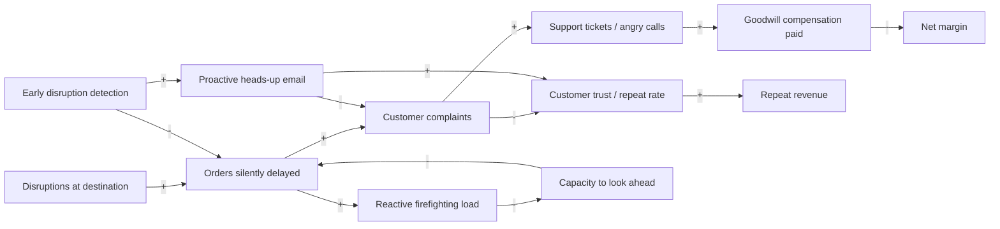
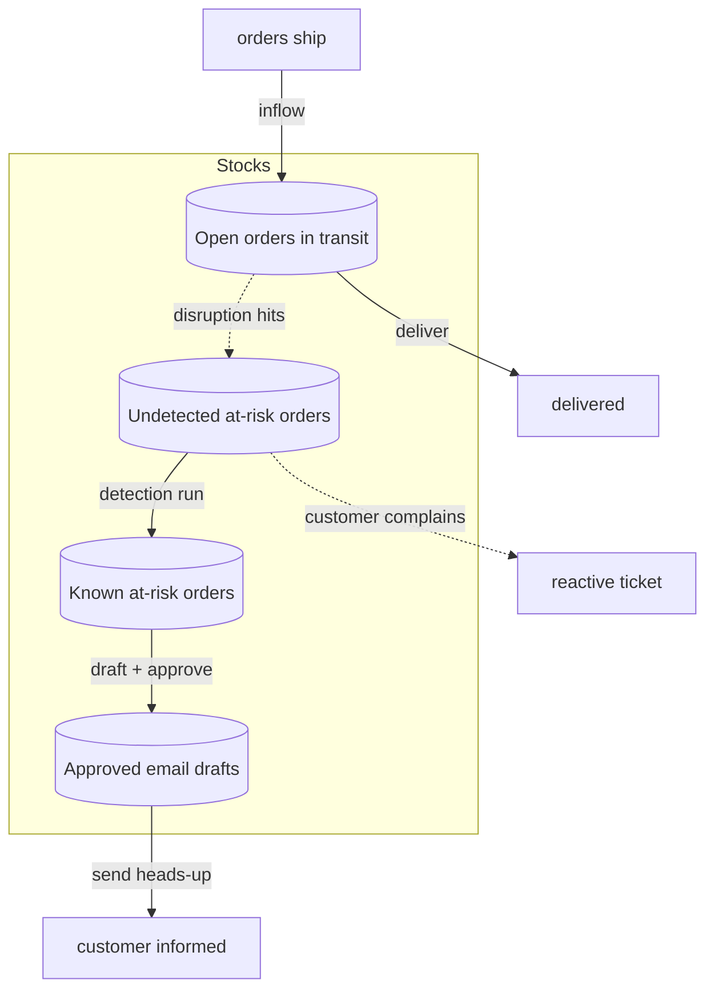
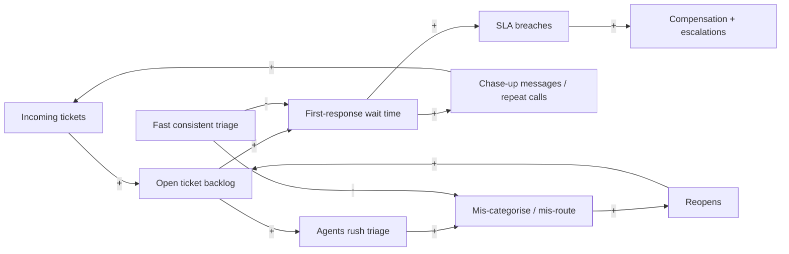
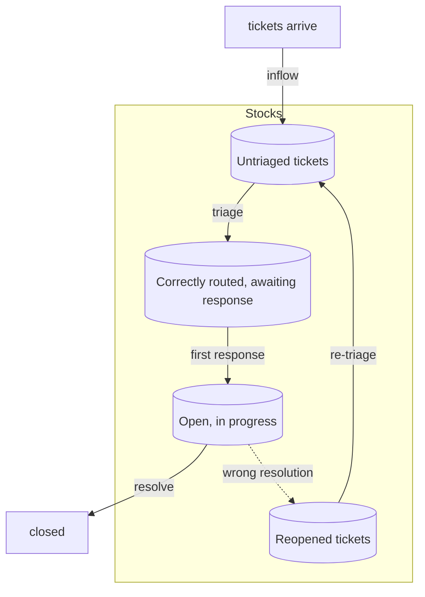
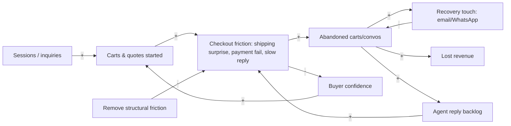
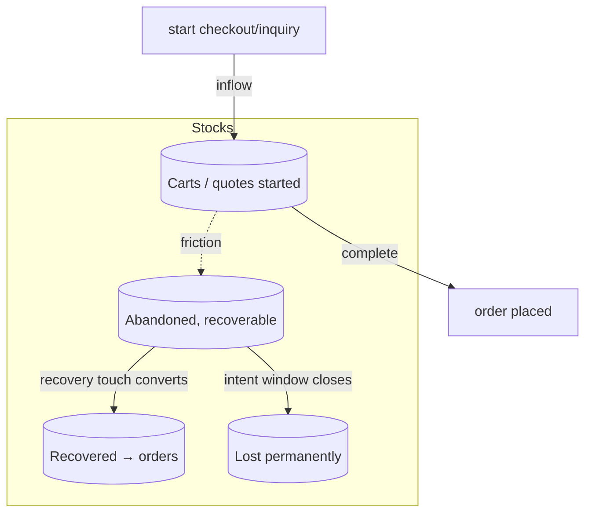
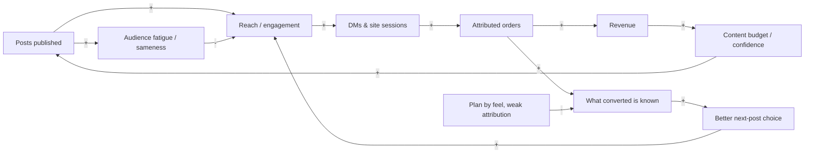
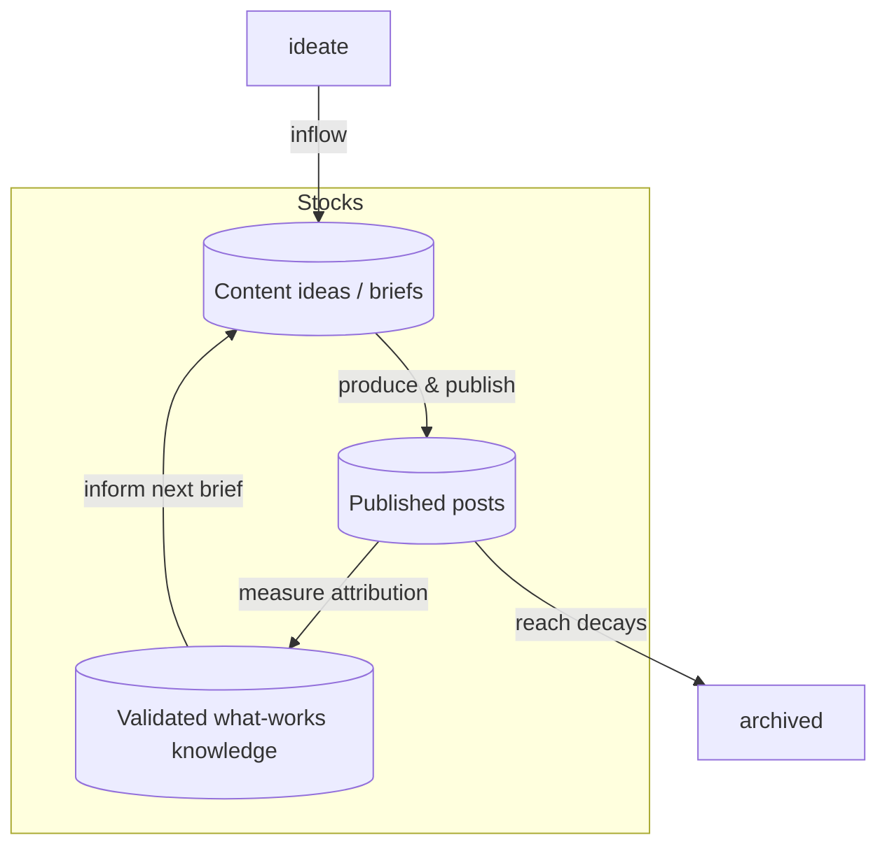

# From Problem to Agent — The LoopCycle Field Book

*A systems-thinking approach to deciding where AI actually belongs in a waste-to-value supply-chain business — and where it does not.*

> **How to read this book.** Analysis earns the solution. No chapter opens with
> "add an AI agent." Each one first characterises the system (Causal Loop
> Diagram → Stock & Flow), finds where it hurts (Theory of Constraints),
> quantifies the prize in money (Throughput Accounting), decides honestly what
> each step actually needs (Automation vs Decision-model vs Agentic), and only
> then designs the solution — proving the architecture attacks the real
> constraint. If a step needs no LLM, this book says so plainly, even when the
> artifact ships as an "agent."

All numbers are drawn from the synthetic datasets in this repository
(`Data/`, June–September 2026, LoopCycle Nusantara). Monetary values are in
**IDR**; approximate rate **1 USD ≈ 15,800 IDR**. Modelled parameters are
labelled as assumptions.

---

## Table of Contents

### Part I — The Method
- [Chapter 0 — Why This Book Exists](#chapter-0--why-this-book-exists)
- [Chapter 0.5 — Meet LoopCycle Nusantara](#chapter-05--meet-loopcycle-nusantara)
- [Chapter 1 — How to Use This Book](#chapter-1--how-to-use-this-book)
- [Chapter 2 — The Four Lenses](#chapter-2--the-four-lenses)
- [Chapter 3 — The Two Agent Patterns](#chapter-3--the-two-agent-patterns)
- [Chapter 3.5 — Understanding Decision Models](#chapter-35--understanding-decision-models)

### Part II — The Cases
- [Chapter 4 — The Delivery Disruption Monitor](#chapter-4--the-delivery-disruption-monitor)
- [Chapter 5 — Support Ticket & Contact-Centre Triage](#chapter-5--support-ticket--contact-centre-triage)
- [Chapter 6 — Cart & Conversation Recovery](#chapter-6--cart--conversation-recovery)
- [Chapter 7 — Content-to-Sales Planning](#chapter-7--content-to-sales-planning)

### Part III — Synthesis
- [Chapter 8 — Patterns Across the Four Cases](#chapter-8--patterns-across-the-four-cases)
- [Chapter 9 — Running This as a Workshop](#chapter-9--running-this-as-a-workshop)
- [Appendix A — Glossary](#appendix-a--glossary)
- [Appendix B — Artifact Index](#appendix-b--artifact-index)

---

# Part I — The Method

## Chapter 0 — Why This Book Exists

Most "AI strategy" starts at the wrong end. Someone names a tool — "let's add an
agent to the contact centre" — and then works backwards to justify it. The tool
arrives before anyone has asked what actually limits the business, whether the
chosen step is even the bottleneck, or whether the step needs a language model
at all. The result is a demo that impresses and a system that doesn't move a
single number that matters.

This book inverts the order. Before any solution is proposed, four pieces of
analysis must be on the table:

1. **A Causal Loop Diagram** — why does the problem *persist*? What feedback
   structure keeps it alive despite everyone's effort?
2. **A Stock & Flow model** — where does work physically *pile up*, and which
   *rate* would a solution have to change to drain it?
3. **A Theory of Constraints pass** — of all the steps, which single one *limits
   the whole system*? (It is almost never the loud one.)
4. **A Throughput Accounting estimate** — what is the prize, *in money*, and does
   the conclusion survive a swing in the shakiest assumption?

Only after those four is a solution allowed on the page — and when it arrives, it
is decomposed honestly into three layers: **deterministic automation** (plain
code), **decision models** (typed choices with calibrated confidence and the
right to abstain), and **deep agents** (the irreducibly LLM-shaped reasoning and
generation). The discipline is the point. A business that can tell these three
apart spends its scarce engineering effort where throughput justifies it — and
stops paying LLM prices for work a `JOIN` could do.

LoopCycle Nusantara is the worked example. Four of its real operational
headaches run through the full arc. By the end you will have seen the method
produce, more than once, the most useful sentence an AI consultant can say:
*"this part doesn't need AI."*

## Chapter 0.5 — Meet LoopCycle Nusantara

**LoopCycle Nusantara** is a waste-to-value social enterprise in Bandung, West
Java, Indonesia, founded in 2015. Its core business is a traceable recycling
supply chain: it formalises **3,500 informal waste pickers**, buys their sorted
plastic at fair-trade rates through **12 collection hubs** across West Java,
pelletises it, and sells recycled resin to FMCG packaging makers. Turnover is
roughly **$4.2 M USD** across **160 staff**.

Sitting on top of that industrial core is a **consumer brand**: the *Loop Tote*,
a recycled-plastic tote bag sold direct-to-consumer and across nine channels
(Shopify, Instagram DM/WhatsApp, Shopee, Tokopedia, TikTok Shop, Lazada, Blibli,
Amazon, and a physical Bandung store). The tote is both a product line and the
company's marketing engine — it is the visible, Instagrammable face of an
otherwise invisible resin business.

The data window (June–September 2026) captures this consumer side in detail:

| Domain | Dataset | Scale |
|---|---|---|
| Orders | `loopcycle_tote_orders.csv` | 2,867 orders, ~849 M IDR revenue, 45.9% GP |
| Abandoned checkouts | `shopify_abandoned_checkouts.csv` | 1,326 (7.4% recovered) |
| Abandoned conversations | `instagram_abandoned_conversations.csv` | 979 (7.4% recovered) |
| Support | `loopcycle_support_tickets.csv` | 37 tickets, 32% SLA breach |
| Calls | `loopcycle_call_centre_log.csv` | 26 calls |
| Social | `loopcycle_instagram_posts_flat.csv` + comments | 30 posts, 1,515 comments |
| Delivery agent | `Data/Agent/hermes-delivery-disruption-monitor/` | 100 demo orders |

**Why these four cases, and why they differ.** They were chosen because they
land in *different places* on this book's honest-assessment scorecard. The
delivery monitor is genuinely agentic (open-web research and judgement). Support
triage is a decision-model problem wearing an agent costume. Cart recovery is
mostly automation with a thin generative edge. Content planning is a
decision-model-and-measurement problem that the market would happily sell you as
"generative AI." Reading them side by side is the fastest way to internalise the
three-way split.

## Chapter 1 — How to Use This Book

**Self-study.** Read Part I once for the method. Then take any Part II chapter
and, *before* reading its Solution Design section, try the four lenses yourself
on the dataset counts given at the top of the chapter. Compare your constraint
and your automation/agentic verdict with the book's. The gap is the lesson.

**In a classroom / workshop.** Each Part II chapter is a ~90-minute case. Run the
four lenses as group exercises (Chapter 9 gives the facilitation rhythm and
discussion prompts), reveal the Throughput Accounting only after the group has
committed to a constraint, and finish on the automation-vs-agentic scorecard —
the moment the room realises half the "AI" ideas were really `JOIN`s is the
workshop's payoff.

**Prerequisites.** No prior systems-thinking background is required; Chapter 2
teaches the four lenses from scratch. For the Solution Design sections, comfort
reading JSON tool schemas and basic Python helps but is not essential. All
datasets are in the repo, so every number is independently checkable.

## Chapter 2 — The Four Lenses

### Lens 1 — Causal Loop Diagram (CLD): *why does it persist?*

A CLD maps the **feedback structure** of a system. Variables are nodes; a signed
arrow means "when the tail moves, the head moves" — `+` in the same direction,
`-` in the opposite. A closed loop is **reinforcing (R)** if it amplifies change
and **balancing (B)** if it resists it. The quick test: *count the minus signs
around the loop — even → reinforcing, odd → balancing.*

Reinforcing loops are the engines of both virtuous and vicious cycles; balancing
loops are the brakes and thermostats. Problems persist when a vicious R-loop
**out-runs** the B-loop meant to correct it — usually because the corrective
loop contains a **delay** (`||`). Leverage, in Donella Meadows' sense, is found
not by pushing harder on the symptom but by changing *loop gain*, *delay length*,
or *who sees what information when*.

### Lens 2 — Stock & Flow: *where does work pile up?*

A stock is an accumulation — a bathtub (orders waiting, tickets open, carts
parked). A flow is a rate — a tap or drain (orders arriving per day, tickets
resolved per hour). **A stock can only change through its flows.** So the single
most useful question a solution must answer is: *which flow rate do you move?* A
solution that doesn't change an inflow or outflow rate cannot change the stock,
no matter how clever it is.

### Lens 3 — Theory of Constraints (ToC): *what limits the whole system?*

Every system has exactly one binding constraint at a time — the stage with the
least capacity relative to demand. Goldratt's **Five Focusing Steps**:

1. **Identify** the constraint. (Beware the obvious: the loud bottleneck is often
   a symptom of a quiet one upstream.)
2. **Exploit** it — get maximum throughput from it for free.
3. **Subordinate** everything else to its pace.
4. **Elevate** it — invest to add capacity (often where automation or a model
   enters).
5. **Repeat** — once relieved, the constraint *migrates*. Naming where it goes
   next is frequently the most valuable finding in the whole analysis.

### Lens 4 — Throughput Accounting: *what is the prize, in money?*

Three terms, adapted from the factory to knowledge work:

- **T (Throughput)** — the rate at which the system generates money through sales
  (revenue minus truly variable cost). *More sales, saved sales, higher margin.*
- **I (Investment / Inventory)** — money tied up in the system (here: work parked
  in stocks — unrecovered carts, open tickets, undetected disruptions).
- **OE (Operating Expense)** — money spent turning I into T (labour, tooling, API
  spend).

Every claim is anchored to a numbered assumption (A1, A2…) with a value and a
basis; dataset-anchored counts are marked as such, modelled parameters as
modelled. We compute **ΔT, ΔI, ΔOE**, then **Net = ΔT − ΔOE** and
**ROI = ΔNet ÷ incremental spend**, and finish with a **sensitivity note**: does
the *sign* of the conclusion survive a sensible swing in the load-bearing
assumption? In knowledge work the win usually shows up in **ΔT** (amplifying a
scarce resource), not ΔOE (cutting cost) — and when the win is pure OE from
repetitive consolidation, that is itself a strong hint the step is *automation*,
not an agent.

## Chapter 3 — The Two Agent Patterns

When a step genuinely needs an LLM, there are two ways to build the loop, and the
choice is really a **governance** decision, not a technical one.

- **Code-based agent (you drive the loop).** Your code calls the model for one
  bounded judgement at a time, inspects the result, and decides the next step.
  Tools are invoked by your code, not by the model. You get auditability,
  deterministic control flow, testable units, and the ability to stop. The cost
  is development effort and some loss of the model's open-ended initiative. Pick
  this when actions are irreversible, regulated, or customer-facing.
- **Skill-based agent (the harness drives the loop).** You hand the model a goal,
  a set of tools, and guardrails, and let it iterate — searching, reading,
  deciding — until done. You get speed of iteration and emergent problem-solving.
  The cost is weaker audit trails and less deterministic behaviour. Pick this for
  research, exploration, and internal-facing synthesis where a human reviews the
  output before it has consequences.

The delivery monitor in Chapter 4 is the instructive hybrid: a **skill-based**
loop for the open-web research (where exploration is the whole point) wrapped by
**code-based** scripts for everything repeatable and testable (loading orders,
business-day maths, drafting), with a **human approval gate** before any email
leaves the building.

## Chapter 3.5 — Understanding Decision Models

Between "plain code" and "a general-purpose LLM" sits a third model class that
most teams forget they can use: the **decision model**. It answers a **typed
question over a fixed set of options** — a category, a yes/no, a severity rating,
a priority — and returns a **calibrated confidence**, with the explicit right to
**abstain** and route to a human when it is unsure.

Why it matters here: several LoopCycle steps are *typed choices* — "which of
these eight categories is this ticket?", "is this cart abandonment price-driven
or friction-driven?", "is this disruption High / Medium / Low?". Handing those to
a generative LLM is overkill: you pay generation cost and latency, you get
free-text that needs parsing, and you lose calibration. A decision model is
smaller, cheaper, faster, auditable, and — critically — *knows when it doesn't
know*, which is exactly the property you need before you let it touch a customer
or an SLA.

Two usable backends:

- **Laya** (<https://github.com/NandhaKishorM/laya>) — open-source, self-hosted,
  encoder-only, calibrated. Best when data is sensitive or must stay on-prem (a
  pickers' payment dispute, masked PII), or when you want no per-call API cost.
- **Microsoft-Decision-1**
  (<https://commandline.microsoft.com/microsoft-decision-1-model-foundry/>) — a
  managed API for structured decisions. Best when the team has no GPU/ops
  capacity and wants calibration without running infrastructure.

The rule carried through every case: **match the model class to the sub-problem.**
Typed choice → decision model. Generation / open-ended reasoning → LLM.
Everything else → code. Don't make one generative model do a scorer's or a
function's job.

---

# Part II — The Cases

## Chapter 4 — The Delivery Disruption Monitor

> **Project:** `Data/Agent/hermes-delivery-disruption-monitor/` · **Domain:** last-mile logistics / proactive customer comms · **Dataset:** 100 demo open orders (34 Ordered · 36 Packed · 30 In-Transit); 85 ID + 15 international destinations; answer key marks 31 orders at disrupted destinations (21 "email customer", 10 monitor-only), 69 controls.

### 4.1 The Problem

LoopCycle ships ~2,867 Loop Tote orders a window across six couriers (SiCepat,
JNE, J&T, GoSend/Grab, in-store, platform couriers), mean ship→delivered **2.6
days** (dataset: `loopcycle_tote_orders.csv`). West Java is exposed to floods,
volcanic ash, haze, strikes and protests that stall deliveries *without the
courier flagging it as a problem* — the parcel simply sits. The operator (a small
ops/CX team) finds out when the **customer complains**: "Delivery delay" is the
single largest support category (5 of 37 tickets) and delivery issues drive both
the angriest calls and the goodwill compensation (37 tickets carry **25.1 M IDR**
of compensation, mean **679 k IDR** each). The repo's Hermes skill reframes this
as: *which open orders will be late, why, by how much, and what do we do* —
answered **before** the customer notices, by searching the live web for
disruptions at each destination, verifying sources, estimating delay, and
drafting (never sending) customer emails for approval.

### 4.2 Lens 1 — Causal Loop Diagram



- **R1 — Firefighting spiral (reinforcing).** `Orders silently delayed → Reactive
  firefighting load → (−) Capacity to look ahead → (−) Orders silently delayed`.
  Two minus signs → reinforcing. The busier the team gets cleaning up late
  deliveries, the less time it has to *anticipate* them, so more go undetected.
  This is the vicious engine.
- **R2 — Trust erosion (reinforcing).** `Complaints → (−) Trust → (−) Repeat
  revenue`, and lower repeat revenue pressures the team to chase new orders
  rather than nurse existing ones, feeding complaints. The erosion compounds.
- **B1 — Compensation thermostat (balancing).** `Complaints → Compensation →
  (−) Margin`. Goodwill payments buy back some trust but drain margin; it caps
  the damage without fixing the cause — a classic "shifting the burden" brake.
- **B2 — Proactive-detection brake (balancing, and the one we want to
  strengthen).** `Early detection → (−) silently delayed`, and `Proactive email →
  (−) complaints / (+) trust`. This is the loop the agent installs.

**Delays.** The killer delay is between a disruption *starting* and LoopCycle
*learning* about it — today that path runs through the customer and a support
ticket (hours to days). B2 collapses that delay from "customer-complaint time" to
"web-search time."

**Leverage points (Meadows order, strongest first).**
1. **Information flow** — give the operator sight of disruptions *before* the
   customer (this is the whole game; it rewires who-knows-what-when).
2. **Delay length** — shrink detection lag from days to one 6-hour scheduled run.
3. **Loop gain on B2** — a proactive heads-up converts an angry complaint into a
   trust-building touch, flipping R2's sign for that order.

**Systemic insight.** R1 dominates today purely because of a *delay*: detection
sits downstream of the complaint. Nothing is wrong with the team's effort — the
*information arrives too late to act*. Move detection upstream and B2 starts
beating R1.

### 4.3 Lens 2 — Stock & Flow



| Stock | Inflow(s) | Outflow(s) | Units |
|---|---|---|---|
| Open orders in transit | orders ship | delivered | orders |
| **Undetected at-risk orders** | disruption hits an open order | detection run **or** customer complaint | orders |
| Known at-risk orders | detection run | draft + approve | orders |
| Approved email drafts | operator approval | send heads-up | emails |

**Which flow rate the solution moves.** The agent attacks exactly one rate: the
**detection outflow** from *Undetected at-risk orders*. Today that stock drains
almost entirely through the slow, damaging path ("customer complains"). The agent
adds a fast drain ("detection run", every 6 hours) so orders leave the undetected
stock *through LoopCycle's eyes, not the customer's inbox*. It cannot change how
many disruptions occur (that inflow is the weather); it changes **how fast, and
through which door, at-risk orders are discovered.**

### 4.4 Lens 3 — Theory of Constraints

| Stage | What happens | Capacity / lead time today |
|---|---|---|
| 1. Detect disruption | Learn a destination is disrupted | **Reactive: hours–days (via complaint)** ← constraint |
| 2. Map to orders | Which open orders go there | Minutes (a `JOIN`) |
| 3. Estimate delay | Days late, revised window | Minutes (rubric + business-day maths) |
| 4. Decide action | Email / monitor / escalate | Minutes (rules + operator) |
| 5. Communicate | Draft + send heads-up | Minutes to draft; approval-gated |

1. **Identify.** The constraint is **Stage 1, detection latency** — not writing
   emails, not the maths. Every downstream stage is already fast; they just start
   too late. The loud symptom (complaints, compensation) is downstream of this
   quiet constraint.
2. **Exploit.** Before spending anything: run the existing team's awareness on a
   *schedule* and *group orders by destination* so one search covers many orders
   (the demo's 100 orders collapse to a handful of destination groups). Exploit =
   stop detecting one-order-at-a-time.
3. **Subordinate.** Everything downstream serves detection's cadence:
   `load_orders.py` pre-builds the search plan and source hints so the moment a
   run fires, searching is frictionless; `assess_orders.py` turns a finding into
   assessments, report and drafts with zero extra latency.
4. **Elevate.** Invest where capacity is genuinely missing: **open-web research
   and source verification at machine speed** — the irreducibly agentic nub. A
   skill-based loop searches each destination group, opens and verifies sources,
   and records findings every 6 hours. This raises detection capacity from
   "when a human happens to look" to "continuous."
5. **Repeat — the constraint migrates.** Once detection is continuous, the
   binding constraint moves to **source quality / verification trust** (is the
   finding real and official?) and then to **operator approval throughput** (can
   a human approve drafts fast enough during a big event?). The design must
   anticipate both: hence `verified`/`confidence` flags and "none found, not
   safe" discipline for the first, and severity-filtered batched drafts for the
   second.

### 4.5 Lens 4 — Throughput Accounting

**T / I / OE here.** **T** = margin saved by preventing delay-driven complaints
(avoided compensation + retained repeat revenue). **I** = at-risk orders sitting
undetected (money exposed to churn/goodwill). **OE** = API/search cost + operator
approval time + a modest build amortisation.

| # | Assumption | Value | Basis |
|---|---|---|---|
| A1 | Orders per window | 2,867 | dataset `tote_orders.csv` |
| A2 | Share of orders hitting a disruption | 5% | modelled; demo key = 31/100 is deliberately enriched, real base rate lower |
| A3 | At-risk orders / window | ~143 | A1 × A2 |
| A4 | GP per order | 135,811 IDR | dataset (GP ÷ orders) |
| A5 | Compensation per escalated delay | 679,000 IDR | dataset (mean comp/ticket) |
| A6 | Share of at-risk that escalate to comp **without** heads-up | 25% | modelled |
| A7 | Heads-up reduces escalation share to | 8% | modelled |
| A8 | Repeat-rate lift from proactive save (of GP) | 10% of GP on saved orders | modelled, conservative |
| A9 | Operator approval time / run | 15 min, ~1.2 runs/day effective review | modelled |
| A10 | Loaded ops cost | 150,000 IDR/hr | modelled |
| A11 | Search/API + infra | 1.5 M IDR / window | modelled |

**Before (reactive).**
- Compensation: 143 × 25% × 679 k = **24.3 M IDR / window**.
- Trust loss: unpriced but real (R2).

**After (proactive heads-up).**
- Compensation: 143 × 8% × 679 k = **7.8 M IDR / window** → **ΔT_comp ≈ +16.5 M
  IDR** (avoided cost behaves like saved throughput).
- Repeat lift: 143 × (25%−8%) saved-from-churn × 135,811 × 10% ≈ **0.33 M IDR**
  (small; the real repeat effect is larger but we keep it conservative).

**ΔOE.** Approval 1.2 runs/day × 0.25 hr × ~120 days × 150 k ≈ **5.4 M IDR** +
search/infra **1.5 M** = **≈ 6.9 M IDR / window**.

| Metric | Before | After | Δ |
|---|---|---|---|
| T (margin saved) | 0 | +16.8 M | **ΔT ≈ +16.8 M IDR** |
| OE | ~0 (hidden in firefighting) | 6.9 M | **ΔOE ≈ +6.9 M IDR** |
| **Net = ΔT − ΔOE** | | | **≈ +9.9 M IDR / window (~$627)** |

**ROI** = ΔNet ÷ incremental spend = 9.9 M ÷ 6.9 M ≈ **1.4×** per window, before
counting the unpriced trust loop (R2) which is the larger prize over time.

**Sensitivity.** The load-bearing assumption is **A2 (disruption base rate)**. At
2% it roughly halves ΔT to ~6.7 M and Net goes near zero; at 8% Net clears 20 M.
A6/A7 (escalation reduction) matter next. **The sign holds for any base rate
above ~3%**, and West-Java flood/haze seasonality plus the data's delivery-delay
prominence make 3%+ plausible. *These are illustrative estimates; a pilot must
replace A2/A6/A7 with measured rates from one real season.*

### 4.6 Automation vs Agentic — An Honest Assessment

| Step | Nature | Throughput contribution | Build effort | Build priority |
|---|---|---|---|---|
| Load orders, filter in-scope statuses | **Automation** | Enabler (0 direct) | Low (`load_orders.py`) | 1 (done) |
| Group destinations, build search plan + source hints | **Automation** | Enabler | Low | 1 (done) |
| **Search web, open & verify sources, find active disruptions** | **Agentic (LLM)** | **Carries ΔT** | High | **2 (the nub)** |
| Classify severity (High/Med/Low) | **Decision model** | Gates which orders notify | Medium | 3 |
| Estimate delay range, compute revised window (business-day maths, skip holidays) | **Automation** | Converts finding → action | Low (`assess_orders.py`) | 1 (done) |
| Decide action (email / monitor / escalate) | **Automation (rules) + operator** | Governs | Low | 1 |
| Draft customer email | **Agentic (LLM), human-approved** | Realises the save | Medium | 3 |
| Score against answer key | **Automation** | Test harness | Low (`evaluate_against_key.py`) | 1 (done) |

**Effort decision.** ΔT ≈ +16.8 M, ΔOE ≈ +6.9 M, Net ≈ +9.9 M, ROI ≈ 1.4× — and
*all* of ΔT flows through exactly one row: **open-web disruption research with
verified sources.** Everything else is cheap deterministic plumbing that already
exists in `scripts/`. Build order is therefore unusually clean: the automation
layer is **already built and testable** (that is why the repo ships four Python
scripts and an answer key), so spend real effort only on (a) the agentic research
loop and (b) the two human-approved generative touches (severity → draft).
Severity classification is a genuine *typed choice* and should be a **decision
model**, not left to the generative LLM — it gates customer contact, so you want
calibration and abstention, not prose.

**Overall verdict: Hybrid, agentic-nub.** This is the one case in the book where
the LLM is load-bearing — but even here, ~70% of the surface area is automation,
and the single most expensive mistake would be to let the generative model also
do the severity scoring and the business-day maths. *Decompose before you
deploy.*

**Break-even / team-sizing.** Assume (labelled): **ARR per B2B/brand customer
contribution ≈ not applicable here — size at the portfolio level** since this
agent protects *consumer* margin. Treat the prize as the Net above:
**~9.9 M IDR/window ≈ 29.7 M IDR/yr (~$1,880/yr)** of protected margin for *one*
LoopCycle-sized tenant.
- Dev cost (1 dev, 1 yr) = loaded_cost × 1 yr × 1.10 run/API uplift. At a
  **$45,000** loaded cost → **$49,500**.
- A single tenant's **$1,880/yr** cannot fund a developer — **break-even team at
  one tenant ≈ 0.04 devs.** This is the honest reading: *as a bespoke build for
  LoopCycle alone, it does not clear break-even.*
- It only clears as a **portfolio / product**: the skill is build-once-reuse. At
  **$1,880/yr × N tenants**, break-even for one full-time dev needs **N ≈ 26
  tenants** (full-ramp) or **~40** (conservative two-thirds ramp). **Verdict:
  clears break-even at one developer once ~26–40 similar e-commerce shippers run
  it** — which is precisely why it ships as a reusable Hermes *skill*, not a
  LoopCycle-internal script.

### 4.7 Solution Design

The repo already embodies the right architecture. Mapped to the layers:

**Automation layer** (deterministic, testable — `scripts/`):
- `load_orders.py(orders, statuses, as_of) → orders_in_scope.csv,
  destinations.json, search_plan.md` — filters scope, groups destinations,
  emits ready queries + `SOURCE_HINTS` per country.
- `assess_orders.py(orders, findings, as_of, holidays) → assessment.{csv,json},
  report.md, customer_emails.csv` — joins findings to orders, applies
  `RUBRIC_DELAY`, computes revised windows via `common.py` business-day maths,
  renders report and drafts, sets `send_allowed` blocks (opt-out, no address,
  demo domains).
- `evaluate_against_key.py` — scores a run against a facilitator key (the test
  harness that keeps the agentic layer honest).

**Decision-model layer** — **severity classification** (High / Medium / Low) over
a finding. Typed question: *"Given this verified disruption and this
destination/order, what notify-severity?"* Fixed options with rubric criteria;
confidence threshold; **abstain → operator review** when sources conflict or
confidence is low (the SKILL already encodes "use the more cautious severity" and
"flag single-source High as `verified:false`"). Backend: **Laya** (on-prem,
calibrated — order PII stays local) or **Microsoft-Decision-1** if no GPU.

**Deep-agent layer** (the irreducible nub) — a **skill-based** web-research loop:
per destination group, run queries → **open** sources (not snippets) → apply the
four tests (active, located, logistics-relevant, sourced) → write
`findings.json` with `verified`/`confidence` and a cited source list; **never
invent**; say *"none found"* not *"safe."* Tools (intent): `web_search(query)`,
`fetch_page(url)`, `write_findings(schema)`. Plus a **code-based, human-gated**
drafting step for customer emails — code-based precisely because it is
irreversible and customer-facing.

**Back to the constraint.** The agentic layer directly elevates the Phase-3
constraint (detection latency). The decision-model + `verified` flags address the
**migrated** constraint (source trust); the severity-filtered, batched,
approval-gated drafts address the *next* migration (operator approval
throughput).

### 4.8 Run It Yourself

```bash
cd Data/Agent/hermes-delivery-disruption-monitor
# Offline dry run (no web search — exercises the deterministic pipeline):
python3 scripts/load_orders.py   --orders examples/demo_orders.csv --out run --as-of 2026-10-13
python3 scripts/assess_orders.py --orders examples/demo_orders.csv \
        --findings examples/sample_findings.json --out run --as-of 2026-10-13
# Score the pipeline against the facilitator key:
python3 scripts/evaluate_against_key.py --assessment run/assessment.csv \
        --key examples/demo_answer_key.csv --out run/evaluation.md
```
Live: in Hermes connect a web-search/fetch tool and say **"check delivery
disruptions."** Review `report.md`, approve drafts before anything sends.

---

## Chapter 5 — Support Ticket & Contact-Centre Triage

> **Project:** `Data/CallCentre_Ticket_Data/` · **Domain:** customer-support operations / SLA management · **Dataset:** 37 tickets (2026-06-03→09-27), 155 threaded messages, 26 inbound calls. **32% SLA breach** (12/37); first-response median **145 min** (mean 387 — long tail); resolution median **49.4 h**; CSAT mean **3.74/5**; **9 reopens**; compensation **25.1 M IDR** total, mean **679 k/ticket**.

### 5.1 The Problem

LoopCycle's support runs across six channels (Phone, WhatsApp, Email, Web form,
Instagram DM, Marketplace chat) feeding one ticket queue. The small CX team
triages by hand: read the ticket, guess the category, set priority, route to a
team, respond. The data shows the cost of doing this by hand under load: a
**32% SLA breach rate**, a first-response distribution whose **mean (387 min) is
2.7× its median (145 min)** — the signature of a few tickets rotting at the back
of the queue — and **9 reopens** signalling misrouted or half-resolved cases.
The categories are heterogeneous (22 distinct categories across 37 tickets, from
"Delivery delay" to "Picker payment delay" to "CoA documentation"), so a
mis-triage sends a resin-quality B2B issue to the consumer team and the clock
runs out. The question: *can triage — categorise, prioritise, route, and draft a
first response — be done consistently and fast enough that the breach rate and
the long tail collapse?*

### 5.2 Lens 1 — Causal Loop Diagram



- **R1 — Chase-up flood (reinforcing).** `Backlog → Wait → Chase-up messages →
  (+) Incoming tickets → Backlog`. Slow first response *manufactures its own
  inbound volume*: customers who waited call again, DM again, open a second
  ticket. The 26 calls and 155 messages against only 37 tickets show this
  multiplication.
- **R2 — Rush-and-reopen (reinforcing).** `Backlog → Agents rush → Mis-route →
  Reopens → (+) Backlog`. Under pressure agents triage faster and worse; the
  9 reopens flow straight back into the queue. Two paths, both vicious.
- **B1 — SLA/compensation brake (balancing).** `Breach → Compensation`, which
  placates customers but drains margin (25.1 M IDR) — relief, not a fix.
- **B2 — Fast-triage brake (the lever).** `Fast consistent triage → (−) wait,
  (−) mis-route`. Strengthening this is the whole intervention.

**Delays.** The damaging delay is between *ticket arrival* and *correct routing*.
Every minute there feeds both R1 (chase-ups) and R2 (rushed mis-routes).

**Leverage points.** (1) **Information/structure** — attach a reliable category +
priority + route *at the instant of arrival*, before a human is free. (2) **Loop
gain on R1** — a fast, acknowledged first response kills the chase-up multiplier.
(3) **Delay length** — collapse triage latency to seconds.

**Systemic insight.** The breach rate isn't a staffing problem first — it's a
*triage-latency and triage-consistency* problem that *creates* phantom volume
(R1) and rework (R2). Fix triage and you simultaneously cut the inflow and the
reopen loop.

### 5.3 Lens 2 — Stock & Flow



| Stock | Inflow(s) | Outflow(s) | Units |
|---|---|---|---|
| **Untriaged tickets** | tickets arrive; reopens | triage | tickets |
| Correctly routed | triage | first response | tickets |
| Open, in progress | first response | resolve / wrong-resolve | tickets |
| Reopened | wrong resolution | re-triage | tickets |

**Which flow rate the solution moves.** The intervention raises the **triage
outflow rate** from *Untriaged tickets* (speed) *and* its **accuracy** (which
shrinks the `wrong-resolution → Reopened → re-triage` recirculation). It does not
add agents (OE) or change arrival volume directly — though faster first response
*indirectly* throttles the R1 inflow. The scarce resource being amplified is
**agent attention**: triage pre-work means every agent-minute lands on a
correctly-routed ticket.

### 5.4 Lens 3 — Theory of Constraints

| Stage | What happens | Capacity / lead time today |
|---|---|---|
| 1. Intake | Ticket lands from a channel | Instant |
| 2. **Triage** (categorise, prioritise, route) | Human reads & classifies | **Serial on scarce agent attention** ← constraint |
| 3. First response | Agent replies | Median 145 min (tail to many hours) |
| 4. Resolve | Agent works the case | Median 49.4 h |
| 5. Close / reopen | Outcome | 9 reopens recirculate |

1. **Identify.** The constraint is **Stage 2 triage**, because it is *serial on
   the same scarce agent attention* that Stages 3–4 need, and because its errors
   create Stage-5 rework that re-enters Stage 2. The loud symptom (SLA breaches at
   Stage 3) is downstream of triage latency and triage error.
2. **Exploit.** For free: enforce a triage *template* (fixed category list, fixed
   priority rubric, fixed routing table) so the human stops re-inventing the
   decision per ticket, and triage the long-tail first (work the queue by SLA
   clock, not arrival order).
3. **Subordinate.** Make Stages 3–4 serve triage: a correctly-routed ticket with
   a suggested-response draft means the responding agent starts from 60% done.
4. **Elevate.** Add triage *capacity that doesn't consume agent attention*: an
   automatic classifier that attaches category + priority + route (+ a draft
   first response) the instant a ticket lands. This is where a **decision model**
   earns its place.
5. **Repeat — migration.** Once triage is instant and accurate, the constraint
   migrates to **Stage 4 resolution capacity** (actual agent problem-solving
   time) and, for the hardest categories (resin quality, CoA, rate disputes), to
   **domain expertise**. The design must route *those* to humans, not pretend to
   resolve them.

### 5.5 Lens 4 — Throughput Accounting

**T / I / OE.** **T** = retained margin from avoided churn + avoided compensation
(a breached, badly-handled ticket costs trust and goodwill cash). **I** = tickets
sitting untriaged/open (exposed to breach). **OE** = agent labour + classifier
infra. Note: this case is *scaled* — 37 tickets is a sample window; we reason per
100 tickets and note LoopCycle's true volume is higher once pickers/B2B are
included.

| # | Assumption | Value | Basis |
|---|---|---|---|
| A1 | SLA breach rate (baseline) | 32% | dataset (12/37) |
| A2 | Compensation per breach-ish ticket | 679,000 IDR | dataset mean comp |
| A3 | Reopen rate | ~24% (9/37) | dataset |
| A4 | Agent triage time (manual) | 6 min/ticket | modelled |
| A5 | Agent first-response + resolve time | 45 min/ticket avg | modelled |
| A6 | Classifier auto-triage accuracy | 85%, abstains on 15% | modelled (decision-model target) |
| A7 | Breach rate after triage-at-arrival | 15% | modelled |
| A8 | Reopen rate after accurate routing | 12% | modelled |
| A9 | Loaded agent cost | 150,000 IDR/hr | modelled |
| A10 | Classifier infra (self-hosted) | 1.0 M IDR / window | modelled |
| A11 | Tickets / window (consumer+picker+B2B, modelled) | 300 | modelled scale-up from 37 sample |

**Before (manual triage, per 300 tickets/window).**
- Compensation: 300 × 32% × 679 k = **65.2 M IDR**.
- Triage labour: 300 × 6 min × 150 k/60 = **4.5 M IDR**.
- Reopen rework: 300 × 24% × 45 min × 150 k/60 = **8.1 M IDR**.

**After (decision-model triage at arrival).**
- Compensation: 300 × 15% × 679 k = **30.6 M IDR** → **ΔT ≈ +34.6 M IDR**.
- Triage labour: human triages only the 15% abstentions: 300 × 15% × 6 min × 150
  k/60 = **0.68 M** → saves **3.8 M IDR** (ΔOE down).
- Reopen rework: 300 × 12% × 45 min × 150 k/60 = **4.05 M** → saves **4.05 M IDR**.

| Metric | Before | After | Δ |
|---|---|---|---|
| T (avoided comp) | — | — | **ΔT ≈ +34.6 M IDR** |
| OE (triage + rework labour) | 12.6 M | 4.73 M + infra 1.0 M = 5.73 M | **ΔOE ≈ −6.87 M IDR (saved)** |
| **Net = ΔT − ΔOE** | | | **≈ +41.5 M IDR / window** |

**ROI** = ΔNet ÷ incremental spend (infra 1.0 M + light integration, say 3 M
amortised) ≈ 41.5 ÷ 4.0 ≈ **~10×** per window on the modelled 300-ticket volume.

**Sensitivity.** Load-bearing assumption is **A7 (post-triage breach rate)**,
which drives nearly all of ΔT. Even if triage only moves breach from 32% → 25%
(a weak result), ΔT ≈ 14.3 M and Net stays firmly positive. The conclusion's
**sign survives** down to ~28% residual breach. A2 (compensation) is dataset-
anchored, strengthening confidence. *Illustrative; a pilot must measure A6/A7 on
one real month and confirm the 300-ticket scale-up.*

### 5.6 Automation vs Agentic — An Honest Assessment

| Step | Nature | Throughput contribution | Build effort | Build priority |
|---|---|---|---|---|
| Ingest ticket from channel, normalise fields | **Automation** | Enabler | Low | 1 |
| **Categorise** into fixed category list | **Decision model** | **Carries ΔT** (routing accuracy) | Medium | **2** |
| **Prioritise** (Normal/High/Low/Urgent) | **Decision model** | Carries ΔT (SLA focus) | Medium | **2** |
| **Route** to team | **Automation** (category→team map) | Converts decision → action | Low | 1 |
| Compute SLA clock, flag at-risk | **Automation** | Focuses the queue | Low | 1 |
| Draft first response | **Agentic (LLM), human-approved** | Speeds Stage 3 | Medium | 3 |
| Resolve hard cases (resin/CoA/disputes) | **Human expert** | — (route, don't automate) | — | — |
| Detect reopen risk / sentiment escalation | **Decision model** | Protects CSAT | Low | 3 |

**Effort decision.** ΔT ≈ +34.6 M, ΔOE saved ≈ 6.9 M, Net ≈ +41.5 M, ROI ≈ 10×.
The prize sits almost entirely in **getting category + priority right at arrival**
— two *typed choices*. That is the textbook decision-model problem, **not** a
generative-LLM problem: you want a fixed label set, calibrated confidence, and an
**abstain → human** path for the 15% hard cases (and for the rare high-stakes
B2B/picker categories where a wrong auto-route is expensive). The first-response
*draft* is the only genuinely generative step, and it is a *speed* enhancer, not
the source of ΔT — build it third, human-approved.

**Overall verdict: Decision-model-heavy (with a thin agentic drafting edge).**
The instinct to "put a support chatbot (LLM) on it" would spend generation cost
and latency on what is fundamentally a *classification* job, and would lose the
calibration and abstention that keep a wrong auto-route from reaching a customer.
*Decompose before you deploy:* the money is in the scorer, not the writer.

**Break-even / team-sizing.** Labelled assumptions: **ARR per customer**
irrelevant (internal ops tool); size on the **Net prize ≈ 41.5 M IDR/window ≈
124.5 M IDR/yr (~$7,880/yr)** of retained margin + saved labour for LoopCycle at
the modelled volume. Dev cost (1 dev, 1 yr, $45k loaded × 1.10) = **$49,500**.
**Max break-even team (single tenant) ≈ 7,880 ÷ 49,500 ≈ 0.16 devs** — i.e. this
is a **~1.9 month** build for one developer that pays for itself inside the first
year. Because a decision model is *trained/adopted once and reused* across all
channels, the right sizing is: **one developer, ~2 months**, clears break-even
comfortably for a single tenant — and the margin widens with LoopCycle's true
(higher) ticket volume. Team size is derived, not asserted; **price/volume
(ticket count × compensation) moves break-even far more than headcount does.**

### 5.7 Solution Design

**Automation layer:**
- `ingest(channel_payload) → normalised_ticket` — unify the six channels' fields.
- `route(category) → team` — fixed category→team table (Delivery→Logistics CX,
  Resin quality→B2B tech, Picker payment→Hub ops, …).
- `sla_clock(ticket) → {due_at, at_risk_bool}` — deterministic SLA maths; sorts
  the queue by time-to-breach, not arrival (exploits the constraint).

**Decision-model layer** (the core):
- **Q1 Category** — typed choice over the fixed category list (dataset shows ~22;
  consolidate to ~10 routable buckets). Confidence threshold; **abstain → human
  triage** below it.
- **Q2 Priority** — typed choice {Urgent, High, Normal, Low} with rubric
  (keywords, requester_type=B2B, sentiment, order value). Abstain → default
  Normal + flag.
- **Q3 Reopen/escalation risk** — binary, protects CSAT; routes high-risk to a
  senior agent.
- Backend: **Laya** (self-hosted, calibrated — tickets carry masked PII and
  picker/B2B data best kept on-prem) or **Microsoft-Decision-1** if no GPU/ops.

**Deep-agent layer** (thin, human-gated): a **code-based** loop that drafts the
first response *conditioned on the decided category* and pulls the matching macro
/ past-resolution snippet; agent proposes, human sends. Code-based because it is
customer-facing and must be auditable.

**Back to the constraint.** The decision-model layer directly elevates the
Phase-3 triage constraint. The SLA-clock automation subordinates the queue to it.
The explicit **human route for hard categories** is the design's answer to the
*migrated* constraint (Stage-4 resolution expertise) — the system is built to
hand those off, not to fake them.

### 5.8 Run It Yourself

No runnable artifact ships for this case yet; it is a design. A pilot:
```bash
# 1. Build a labelled set from the 37 tickets + 155 messages (category, priority).
# 2. Fine-tune / configure a decision model (Laya) on the label set; hold out 20%.
# 3. Measure accuracy, calibration, and abstention rate; require abstain<20%,
#    accuracy>85% on held-out before routing anything automatically.
# 4. Shadow-run for one window: classify live, compare to human triage, do not act.
# 5. Go live on category+priority+route; keep first-response drafting human-approved.
```

---

## Chapter 6 — Cart & Conversation Recovery

> **Project:** `Data/Sales_Data/Abandoned_Carts/` · **Domain:** e-commerce conversion recovery · **Dataset:** 1,326 Shopify abandoned checkouts (**7.4% recovered**, mean cart **274,973 IDR**) + 979 Instagram DM/WhatsApp abandoned conversations (**7.4% recovered**, mean quote **271,805 IDR**, agent first-reply median **24 min**). Top Shopify reasons: unexpected_shipping_cost 226, payment_failed 225, distracted 163. Top IG reasons: price_concern 221, **slow_agent_reply 189**, colour/sold-out 114, shipping_cost 113.

### 6.1 The Problem

Two parallel leaks. On the Shopify storefront, **1,326 checkouts** were started
and abandoned, only **98 (7.4%)** recovered. On Instagram DM/WhatsApp, **979
sales conversations** reached a quote and died, only **72 (7.4%)** recovered. The
abandonment *reasons* are the story: on web, the top two — **unexpected shipping
cost (226)** and **payment failed (225)** — are *structural and fixable without
AI*; on social, the standout avoidable reason is **slow_agent_reply (189)**, with
agent first-reply already a median of 24 minutes (and a long tail). At a mean
cart of ~275 k IDR and 45.9% GP (≈126 k GP/cart), the parked money is large:
1,228 unrecovered web carts × 126 k ≈ **155 M IDR** of GP sitting in a bathtub.
The question: *which recovery actions actually move the recovery rate, and which
of them need a model at all?*

### 6.2 Lens 1 — Causal Loop Diagram



- **R1 — Friction→abandon→backlog (reinforcing).** `Abandoned convos → (+) agent
  reply backlog → (+) friction (slow reply) → (+) abandon`. On the social side,
  every un-replied inquiry worsens the backlog that causes the next slow reply.
  slow_agent_reply (189) is this loop made visible.
- **R2 — Confidence erosion (reinforcing).** `Friction → (−) buyer confidence →
  (−) carts started`. Shipping surprises and payment failures teach buyers to
  distrust checkout, suppressing future starts.
- **B1 — Recovery-touch brake (balancing).** `Abandon → recovery email/WhatsApp →
  (−) abandon`. Today weak: 7.4% recovery means B1 is barely braking.
- **B2 — Fix-the-friction brake (the strongest lever, and *not* AI).** `Remove
  structural friction → (−) friction`. Showing shipping cost earlier and fixing
  the payment path attacks the two biggest web reasons at the source.

**Delays.** Recovery touches that arrive late (hours after abandonment) miss the
buyer's intent window — the delay in B1 is why its gain is low.

**Leverage points.** (1) **Structure** — remove the friction that *causes*
abandonment (shipping transparency, payment retry) beats recovering it after.
(2) **Delay** — fire the recovery touch within minutes, not hours. (3) **Loop
gain on R1** — cut agent reply latency on social to kill the backlog spiral.

**Systemic insight.** The headline instinct is "AI to recover carts." But the
two biggest web reasons are *structural* (B2, pure automation/UX), and the
biggest avoidable social reason is *latency* (R1, an auto-acknowledge + fast
quote, barely any AI). The genuinely model-shaped slice — personalised,
well-timed recovery copy — is real but *third* in size.

### 6.3 Lens 2 — Stock & Flow



| Stock | Inflow(s) | Outflow(s) | Units |
|---|---|---|---|
| Carts / quotes started | start checkout/inquiry | complete / abandon | carts |
| **Abandoned, recoverable** | friction | recovery conversion / permanent loss | carts |
| Recovered → orders | recovery touch converts | — | orders |

**Which flow rate the solution moves.** Two rates, two different interventions.
**(a)** Reduce the **abandon inflow** into *Abandoned* by removing structural
friction (B2 — automation/UX, the biggest effect). **(b)** Raise the **recovery
conversion outflow** from *Abandoned* before the intent window closes (B1 — fast
auto-touch + a thin layer of personalised copy). The scarce resource is **buyer
intent**, which decays fast — so *timing* (a flow-rate property) matters more
than cleverness.

### 6.4 Lens 3 — Theory of Constraints

| Stage | What happens | Capacity / lead time today |
|---|---|---|
| 1. Attract | Session / inquiry arrives | OK |
| 2. **Convert checkout** | Buyer completes payment | **Structural friction: shipping surprise + payment fail (451 of 1,326 reasons)** ← web constraint |
| 2′. **Reply to inquiry** (social) | Agent quotes & answers | **slow_agent_reply (189)** ← social constraint |
| 3. Recover | Touch brings buyer back | 7.4% — weak |

1. **Identify.** *Two* constraints on two channels. Web: **checkout friction**
   (shipping transparency + payment reliability) — 451 of the top reasons are
   structural, not persuasion. Social: **agent reply latency** — the backlog
   spiral (R1). Recovery copy is *not* the constraint; it is downstream of both.
2. **Exploit.** Free wins: surface the shipping quote on the product page (kills
   "unexpected_shipping_cost"); add an instant payment-retry link on failure
   (addresses "payment_failed", "payment_page_expired"); auto-acknowledge every
   IG inquiry in <1 min with price + colours (kills most "slow_agent_reply").
3. **Subordinate.** Recovery touches serve the constraint: fire within minutes,
   pre-filled with the exact cart/quote, so the buyer completes in one tap.
4. **Elevate.** Only *here* does a model help: choose the *best recovery
   message/offer per abandoned cart* (reason-aware copy, timing, incentive) — a
   bounded personalisation step. Even this leans decision-model (pick the
   template/offer) more than open generation.
5. **Repeat — migration.** Fix friction and latency and the constraint migrates
   to **offer economics** (is a voucher worth the margin?) and **inventory**
   (colour/sold-out, reason #3 on social — 114) — a *merchandising* constraint no
   recovery message can solve. Name it so no one tries to.

### 6.5 Lens 4 — Throughput Accounting

**T / I / OE.** **T** = GP from recovered carts + GP from carts never abandoned
(friction removed). **I** = GP parked in abandoned carts. **OE** = email/WhatsApp
infra + the personalisation model + minor dev.

| # | Assumption | Value | Basis |
|---|---|---|---|
| A1 | Web abandoned carts / window | 1,326 | dataset |
| A2 | Social abandoned convos / window | 979 | dataset |
| A3 | GP per cart | ~126,000 IDR | dataset (45.9% of 274,973) |
| A4 | Baseline recovery rate | 7.4% | dataset (both channels) |
| A5 | Share of web abandons that are structural (shipping+payment) | 34% | dataset (451/1,326) |
| A6 | Friction removal recovers of structural | 40% | modelled |
| A7 | Recovery rate after fast touch + personalisation | 14% | modelled |
| A8 | Personalisation infra + touch sends | 3.0 M IDR / window | modelled |
| A9 | One-off friction/UX dev | 20 M IDR, amortised 10 windows → 2.0 M | modelled |

**Prize — structural friction removal (B2, automation):**
1,326 × 34% × 40% × 126 k ≈ **22.7 M IDR GP / window**. *No model involved.*

**Prize — recovery-rate lift (B1, fast touch + light model):**
(web+social) 2,305 abandoned × (14% − 7.4%) × 126 k ≈ **19.2 M IDR GP / window.**

| Metric | Before | After | Δ |
|---|---|---|---|
| T (recovered + un-abandoned GP) | baseline 7.4% | +friction fix +lift | **ΔT ≈ +41.9 M IDR / window** |
| OE | ~0 | infra 3.0 M + amortised dev 2.0 M | **ΔOE ≈ +5.0 M IDR** |
| **Net = ΔT − ΔOE** | | | **≈ +36.9 M IDR / window** |

**ROI** ≈ 41.9 ÷ 5.0 ≈ **~8×** per window — and note **~55% of ΔT (the 22.7 M)
requires no AI at all.**

**Sensitivity.** Load-bearing: **A7 (post-touch recovery rate)** and **A6
(friction-fix yield)**. If A7 is only 10% (modest), the lift prize falls to ~7.5
M but the *structural* 22.7 M is untouched, so Net stays ≈ +25 M. The conclusion
is robust precisely *because* its larger half is automation, not a model whose
yield is uncertain. *Illustrative; pilot A6/A7 per channel.*

### 6.6 Automation vs Agentic — An Honest Assessment

| Step | Nature | Throughput contribution | Build effort | Build priority |
|---|---|---|---|---|
| Show shipping cost on PDP; shipping calculator | **Automation / UX** | **Carries ~half ΔT** | Low–Med | **1** |
| Payment-retry link on failure; expiry extension | **Automation** | Carries ΔT | Low | **1** |
| Auto-acknowledge IG inquiry (price+colours) <1 min | **Automation** | Kills R1 latency | Low | **1** |
| Detect abandonment + fire timed recovery touch | **Automation** (rules/trigger) | Enables B1 | Low | 1 |
| Classify abandonment reason | **Decision model** | Targets the touch | Low | 2 |
| Pick recovery template/offer per reason | **Decision model** | Lifts recovery rate | Medium | 2 |
| Write personalised recovery copy | **Agentic (LLM)** | Marginal lift | Medium | 3 |
| Decide voucher economics | **Automation** (margin rule) | Protects GP | Low | 2 |

**Effort decision.** ΔT ≈ +41.9 M, ΔOE ≈ +5.0 M, Net ≈ +36.9 M, ROI ≈ 8×. The
single most important finding: **the biggest throughput row is pure
automation/UX** (shipping transparency + payment retry + instant IG
auto-reply) — build those *first*, they need no model and no data science. The
*decision-model* rows (reason classification → template/offer selection) carry
the recovery-rate lift and are the sensible second investment. **Generative copy
is third and smallest** — a nice-to-have, not the prize.

**Overall verdict: Automation-first hybrid.** Marketed as "AI cart recovery,"
this case is majority plumbing and UX, a decision model in the middle, and only a
sliver of genuine generation. *Decompose before you deploy:* a team that bought a
generative "recovery AI" and skipped the shipping-cost fix would spend model
money to recover carts its own checkout was manufacturing.

**Break-even / team-sizing.** Prize **Net ≈ 36.9 M IDR/window ≈ 110.7 M IDR/yr
(~$7,000/yr)** for LoopCycle. Dev cost (1 dev, 1 yr, $45k × 1.10) = **$49,500**.
**Max break-even team (single tenant) ≈ 7,000 ÷ 49,500 ≈ 0.14 devs** — a **~1.7
month** single-developer build that pays back inside year one. Because the
automation/UX layer is standard commerce engineering and the decision model is
build-once-reuse across channels, the derived sizing is **one developer, ~6–8
weeks**, clearing break-even comfortably. Conservative (2/3 ramp) reading still
≈ 0.09 devs — fine. Price/volume (cart count × GP) dominates headcount; team
size is derived, not asserted.

### 6.7 Solution Design

**Automation layer** (the majority, build first):
- `shipping_quote(cart) → cost` surfaced on PDP + cart (not at the final step).
- `payment_retry_link(failed_checkout) → url`; `extend_expiry(checkout)`.
- `auto_ack(ig_inquiry) → reply` within 60s with price, colours, stock, buy link.
- `on_abandon(cart) → schedule_touch(t+Δ)` deterministic trigger with the exact
  cart pre-filled.
- `voucher_ok(cart) → bool` margin-rule guard before any discount is offered.

**Decision-model layer:**
- **Q1 Reason** — typed choice over the modelled reason set (dataset ships the
  labels). Calibrated; abstain → generic touch.
- **Q2 Best action** — typed choice {reminder, shipping-reassurance,
  payment-help, small-voucher, colour-alternative, no-touch} with confidence.
  Abstain → default reminder. Backend **Laya** (buyer PII on-prem) or
  **Microsoft-Decision-1**.

**Deep-agent layer** (thin): a **skill-based** copy generator that writes the
recovery message *given* the chosen action and cart — internal-facing, reviewed
in aggregate (not per-message), so skill-based iteration speed is acceptable.

**Back to the constraint.** Automation attacks the Phase-3 web constraint
(checkout friction) and social constraint (reply latency) head-on. The
decision-model layer raises B1's gain. The **voucher margin rule** and an
explicit *out-of-stock → merchandising* flag address the *migrated* constraints
(offer economics, inventory) — the design refuses to paper over a sold-out colour
with a recovery email.

### 6.8 Run It Yourself

No shipped artifact; a staged pilot:
```bash
# Stage 1 (automation, no AI): add PDP shipping estimate + payment-retry link.
#   Measure abandon-reason mix shift over one window — expect shipping/payment to fall.
# Stage 2 (decision model): label abandons by reason from the dataset; train Laya;
#   A/B timed touches (reason-aware template) vs generic. Target recovery 7.4%→12%+.
# Stage 3 (generation): add personalised copy only where Stage 2 shows headroom.
```

---

## Chapter 7 — Content-to-Sales Planning

> **Project:** `Data/Post_Data/` + `Data/Sales_Data/loopcycle_tote_post_sales_lift.csv` · **Domain:** social-content strategy / marketing attribution · **Dataset:** 30 Instagram posts (median reach **4,577**, median engagement **8.26%**), 1,515 comments, 8 modelled sales-lift events. Content pillars: loop_tote 8, picker_stories 6, process_impact 6, behind_the_scenes 5, education 3, b2b_partners 2. Formats: VIDEO 11, CAROUSEL 11, IMAGE 8.

### 7.1 The Problem

Instagram is LoopCycle's demand engine — 606 orders are attributed to Instagram
DM/WhatsApp and the sales-lift file shows posts driving real spikes. But the lift
is **wildly uneven**: a single `batik_reel` (reach 20,392) is credited with
**545 attributed orders** and a +454% 24-hour lift, while a `care_carousel`
produced a **0% lift** and `quiz_image` just +14%. The content team plans by
feel: they publish across six pillars and three formats with no reliable read on
*which post shape, pillar, and timing actually convert* versus merely entertain.
With only 30 posts and 8 lift events, the data is thin — which is itself the key
finding. The question: *how should LoopCycle decide what to post next so scarce
creative effort lands on sales-driving content — and does that decision need
generative AI?*

### 7.2 Lens 1 — Causal Loop Diagram



- **R1 — Virtuous content flywheel (reinforcing).** `Posts → Reach → Inquiries →
  Orders → Revenue → Budget → Posts`. When content works, it funds more content.
  The batik_reel is this loop firing.
- **R2 — Learning loop (reinforcing, currently weak).** `Orders → What converted
  is known → Better next choice → Reach`. This *should* compound, but
  `Plan by feel, weak attribution → (−) learning` keeps its gain near zero — the
  team doesn't reliably know *why* batik_reel worked, so it can't repeat it.
- **B1 — Fatigue brake (balancing).** `Posts → Audience fatigue → (−) reach`.
  Posting more of the same decays reach; a real ceiling on brute-force volume.

**Delays.** Attribution delay: the link from a post to the orders it caused is
blurry and arrives late, starving R2. That delay is why planning stays
feel-based.

**Leverage points.** (1) **Information** — a clean, fast read of *which
post attributes drove orders* (closes R2). (2) **Loop gain on R2** — turn each
post into a measured experiment so learning compounds. (3) **Delay** — shorten
the post→attribution read from "vibes next quarter" to "per-post within days."

**Systemic insight.** The constraint is not creativity or generation — LoopCycle
already produces varied content. It is the **broken learning loop (R2)**: weak
attribution means the flywheel can't be *steered*. The prize is in *measurement
and choice*, not in generating more posts.

### 7.3 Lens 2 — Stock & Flow



| Stock | Inflow(s) | Outflow(s) | Units |
|---|---|---|---|
| Content ideas / briefs | ideate (informed by knowledge) | produce & publish | briefs |
| Published posts | produce & publish | reach decays | posts |
| **Validated what-works knowledge** | measure attribution | (feeds briefs) | insights |

**Which flow rate the solution moves.** The intervention raises the **"measure
attribution" inflow** into *Validated what-works knowledge* — the rate at which
each published post becomes a reusable insight. Today that rate is near zero
(feel-based planning), so the knowledge stock never fills and briefs stay guesses.
It does **not** try to raise the "ideate/produce" rate — generating more posts
without closing R2 just hits the fatigue brake (B1). Amplify *learning rate*, not
*output rate*.

### 7.4 Lens 3 — Theory of Constraints

| Stage | What happens | Capacity / lead time today |
|---|---|---|
| 1. Ideate | Come up with post concepts | Not scarce (team is creative) |
| 2. Produce | Shoot/edit a post | Some cost, not the binding limit |
| 3. Publish | Post goes live | Instant |
| 4. **Attribute / learn** | Know which posts drove orders | **Weak, slow, feel-based** ← constraint |
| 5. Choose next | Decide next brief | Starved by Stage 4 |

1. **Identify.** The constraint is **Stage 4, attribution/learning** — not
   ideation or production. The team can make content; what it cannot do is
   reliably *tell what worked and choose accordingly*. The loud activity
   (publishing) hides the quiet missing capability (measuring).
2. **Exploit.** Free: use the data already captured — `post_sales_lift.csv`,
   `attributed_ig_post_id` on orders, per-post reach/engagement — to rank past
   posts by *attributed orders per unit reach*, exposing that reels + batik/design
   pillars convert and quiz/care posts don't.
3. **Subordinate.** Make ideation/production serve the learning signal: brief the
   next posts to *replicate* the proven attributes (reel format, batik/design
   theme) and *stop* producing proven non-converters.
4. **Elevate.** Add attribution capacity: a lightweight model that **predicts a
   new brief's expected attributed-orders band** from its attributes (format,
   pillar, timing, hook) and flags low-confidence briefs for a human — a
   *decision/estimation* model, not a generator.
5. **Repeat — migration.** Once attribution is solid and the team reliably makes
   converting content, the constraint migrates to **production capacity** (can we
   shoot enough reels?) and then to **audience fatigue / reach ceiling** (B1) —
   at which point *paid amplification* or *new audiences*, not more organic posts,
   is the next move. Name it: the learning model buys you a production problem,
   which is a good problem.

### 7.5 Lens 4 — Throughput Accounting

**T / I / OE.** **T** = GP from *incremental* attributed orders won by steering
content toward converters. **I** = creative effort tied up in posts that don't
convert. **OE** = analytics/model + the (unchanged) content production cost.

| # | Assumption | Value | Basis |
|---|---|---|---|
| A1 | Posts / window | 30 | dataset |
| A2 | Attributed orders across lift events | 972 (sum of 8 events) | dataset `post_sales_lift.csv` |
| A3 | GP per order | 135,811 IDR | dataset |
| A4 | Share of posts that are weak converters | ~40% | dataset (quiz/care/some image ≈ low lift) |
| A5 | Reallocating effort to proven shapes lifts attributed orders by | 25% | modelled |
| A6 | Analytics + estimation model cost | 2.0 M IDR / window | modelled |
| A7 | Production cost unchanged (reallocated, not increased) | 0 Δ | modelled |

**Before.** 972 attributed orders/window × 135,811 ≈ **132 M IDR GP** from
content, planned by feel; ~40% of creative effort on non-converters.

**After (steer by measured attribution).**
- Incremental attributed orders: 972 × 25% = **243 orders** → 243 × 135,811 ≈
  **33 M IDR GP / window** → **ΔT ≈ +33 M IDR**.
- Production spend unchanged (effort *reallocated* from losers to winners).

| Metric | Before | After | Δ |
|---|---|---|---|
| T (content-attributed GP) | 132 M | 165 M | **ΔT ≈ +33 M IDR / window** |
| OE | content cost C | C + 2.0 M | **ΔOE ≈ +2.0 M IDR** |
| **Net = ΔT − ΔOE** | | | **≈ +31 M IDR / window** |

**ROI** ≈ 33 ÷ 2.0 ≈ **~16×** per window — *if* the attribution signal is real.

**Sensitivity.** This is the **shakiest** case in the book and the honesty
matters: ΔT rests on **A2/A5** and on the credibility of modelled attribution
from **only 8 lift events and 30 posts**. If the "25% reallocation lift" is really
10%, ΔT falls to ~13 M — still Net-positive, but the confidence interval is wide.
If attribution is largely spurious (reels reach more *because they're reels*, not
because of content choice), ΔT could approach zero. **The sign is likely positive
but is the least certain in the book.** *This case must start as measurement, not
automation — a pilot that first proves attribution is causal before any effort is
reallocated.*

### 7.6 Automation vs Agentic — An Honest Assessment

| Step | Nature | Throughput contribution | Build effort | Build priority |
|---|---|---|---|---|
| Join posts ↔ attributed orders ↔ reach/engagement | **Automation** | **Enabler for all ΔT** | Low | **1** |
| Rank posts by attributed-orders-per-reach | **Automation** | Surfaces what works | Low | **1** |
| Classify post attributes (format/pillar/hook) | **Automation** (metadata) + light model | Enabler | Low | 1 |
| **Predict a brief's expected attributed-orders band** | **Decision/estimation model** | **Carries ΔT** | Medium | 2 |
| Flag low-confidence briefs for human | **Decision model (abstain)** | Protects against bad bets | Low | 2 |
| Generate caption / hook variants for a chosen brief | **Agentic (LLM)** | Marginal (speeds production) | Low–Med | 3 |
| Decide paid amplification budget | **Automation** (ROAS rule) | Addresses migrated constraint | Low | 3 |

**Effort decision.** ΔT ≈ +33 M, ΔOE ≈ +2.0 M, Net ≈ +31 M, ROI ≈ 16× — but
*gated on attribution being causal*. The prize sits in **measurement
(automation) + a brief-outcome estimation model (decision model)**. Generative
caption-writing — the thing most teams would call "the AI content strategy
tool" — is the **lowest-value row** here: it speeds production of posts whose
*selection* is where the money is. Build the join + ranking (pure SQL/pandas)
first; it may alone be enough to steer the team. Add the estimation model second.
Add generation last, if at all.

**Overall verdict: Decision-model + measurement (NOT generative).** This is the
case most likely to be mis-sold as "generative AI for content," and the one where
that framing is most wrong. The scarce resource is *validated knowledge of what
converts*, produced by **measurement**, not by generating more copy. *Decompose
before you deploy:* a `GROUP BY format, pillar` over the existing data is the
single highest-ROI first move, and it contains no model at all.

**Break-even / team-sizing.** Prize **Net ≈ 31 M IDR/window ≈ 93 M IDR/yr
(~$5,900/yr)** for LoopCycle *at the modelled lift* — discount heavily for
attribution uncertainty (say 50% haircut → ~$2,950/yr credible). Dev cost (1 dev,
1 yr, $45k × 1.10) = **$49,500**. **Max break-even team (single tenant,
haircut) ≈ 2,950 ÷ 49,500 ≈ 0.06 devs** — i.e. **~3 weeks** of one developer's
time, which is exactly the right size: the first deliverable is an analytics
notebook, not a product. **Verdict: a few weeks of one analyst/developer clears
break-even even on the conservative, attribution-haircut reading** — but spend on
the *measurement* first and only fund the estimation model once attribution is
proven causal. Team size derived; the dominant lever is whether the attribution
signal is real, not headcount.

### 7.7 Solution Design

**Automation layer** (build first, may suffice):
- `attribution_table()` — join `instagram_posts_flat` + `post_sales_lift` +
  orders' `attributed_ig_post_id` → one row per post with
  reach/engagement/attributed-orders/GP.
- `rank_posts()` — attributed-orders-per-1k-reach, sliced by format & pillar;
  emits "do more of / stop doing" lists (today: more reels + batik/design; fewer
  quiz/care static images).
- `brief_metadata(brief) → {format, pillar, hook_type, timing}` — structured tags.

**Decision-model layer:**
- **Q1 Expected outcome band** — estimate {low / medium / high attributed-orders}
  for a proposed brief from its metadata, with calibrated confidence; **abstain →
  human picks** when the brief is novel/out-of-distribution (common, given only
  30 training posts — the model must *know* its data is thin). Backend **Laya**
  (small data, on-prem, calibration-first) fits better than a managed API here.

**Deep-agent layer** (optional, last): a **skill-based** caption/hook generator
that drafts variants *for a brief the decision model rated high* — generation in
service of a validated selection, never leading it.

**Back to the constraint.** The automation + estimation model directly elevate
the Phase-3 learning constraint (close R2). The ROAS/paid-amplification rule and
the "abstain on novel briefs" behaviour address the *migrated* constraints
(production ceiling, audience fatigue) — the design explicitly declines to pretend
a thin dataset supports confident prediction.

### 7.8 Run It Yourself

```bash
# The highest-ROI first move needs no model — just the join:
python3 - <<'PY'
import csv, collections
posts={r['id']:r for r in csv.DictReader(open('Data/Post_Data/loopcycle_instagram_posts_flat.csv'))}
lift=list(csv.DictReader(open('Data/Sales_Data/loopcycle_tote_post_sales_lift.csv')))
for r in sorted(lift, key=lambda x:-int(x['modeled_attributed_orders'])):
    print(f"{r['post_tag']:18} {r['format']:9} reach={r['ig_reach']:>6} attr_orders={r['modeled_attributed_orders']:>4}")
PY
# Then: GROUP BY format & pillar to get the "do more / stop" lists before any model.
```

---

# Part III — Synthesis

## Chapter 8 — Patterns Across the Four Cases

Four cases, run through the same arc, reveal patterns the individual chapters
only hint at.

### 8.1 The constraint is almost never the obvious step

| Case | Loud symptom | Actual constraint (Phase 3) |
|---|---|---|
| Delivery monitor | Angry calls, compensation | **Detection *latency*** (finding out via the customer) |
| Support triage | SLA breaches at first-response | **Triage latency + accuracy** upstream |
| Cart recovery | Low recovery rate | **Checkout friction + reply latency** (not the recovery copy) |
| Content planning | "We don't post enough / the right things" | **Broken attribution/learning loop** (not creativity) |

In every case the money-moving constraint sat *upstream and quieter* than the
symptom everyone pointed at. The discipline of the four lenses is precisely what
stops a team from "solving" the loud symptom and leaving the constraint intact.

### 8.2 Where the money shows up differs — and that changes the pitch

| Case | Primary win | ΔT | ΔOE | Net / window | What it means |
|---|---|---|---|---|---|
| Delivery monitor | ΔT (saved margin) | +16.8 M | +6.9 M | **+9.9 M** | Amplify scarce *detection* |
| Support triage | ΔT **and** OE saved | +34.6 M | −6.9 M | **+41.5 M** | Classification + labour save |
| Cart recovery | ΔT (half automation) | +41.9 M | +5.0 M | **+36.9 M** | Fix friction, then recover |
| Content planning | ΔT (uncertain) | +33 M | +2.0 M | **+31 M*** | Learn, don't generate |

\*attribution-gated; the least certain. When the win is **ΔT**, pitch it as
*growth / protected revenue*. When it is **OE** (parts of support triage), it is
*efficiency* — and OE-dominant wins are a tell that the step is **automation**,
not an agent. Support triage is the instructive mix: it saves labour *and* grows
retained margin, which is why it has the best Net of the four.

### 8.3 The constraint always migrates — plan for Step 5

| Case | Constraint migrates to… | Design response |
|---|---|---|
| Delivery monitor | Source trust → operator approval throughput | `verified`/`confidence` flags; batched approval |
| Support triage | Stage-4 resolution expertise | Explicit human route for hard categories |
| Cart recovery | Offer economics → inventory (sold-out) | Voucher margin rule; merchandising flag |
| Content planning | Production ceiling → audience fatigue | ROAS/paid rule; abstain on novel briefs |

A solution that doesn't let you *see the next constraint* is a dead end. Every
chapter names its migration and designs for it.

### 8.4 Code-based vs skill-based — the governance call

| Case | Loop choice | Why |
|---|---|---|
| Delivery monitor | **Skill-based** research + **code-based** drafting/approval | Explore the open web; gate anything customer-facing |
| Support triage | **Code-based** drafting | Customer-facing, auditable |
| Cart recovery | **Skill-based** copy (reviewed in aggregate) | Internal-facing, iteration speed |
| Content planning | **Skill-based** caption variants (last, optional) | Low stakes, human picks |

The pattern: **skill-based where exploration/iteration is the point and a human
reviews before consequences; code-based the moment an action is irreversible,
regulated, or lands directly on a customer.**

### 8.5 The honest automation / decision / agentic scorecard

| Case | Automation | Decision model | Agentic (LLM) | Overall verdict |
|---|---|---|---|---|
| **Delivery monitor** | Load, group, delay maths, drafting plumbing (~70%) | Severity classification | **Open-web research (load-bearing)** + approved drafts | **Hybrid, agentic-nub** |
| **Support triage** | Ingest, route, SLA clock | **Category + priority + reopen risk (the prize)** | Thin first-response draft | **Decision-model-heavy** |
| **Cart recovery** | **Shipping/payment/auto-ack (half the ΔT)** | Reason + action selection | Thin personalised copy | **Automation-first hybrid** |
| **Content planning** | **Join + ranking (the first move)** | Brief-outcome estimation | Caption variants (last) | **Decision-model + measurement, NOT generative** |

**The through-line.** Only **one** of four cases has an LLM as its load-bearing
component (delivery research). In the other three, the thing most people would
buy as "an AI agent" is really a **decision model** or **plain automation**, and
the generative LLM is the *smallest, last* layer. Three of four "AI use cases"
would be mostly mis-spent if built generation-first. *That contrast is the book's
most valuable finding.*

### 8.6 What the workforce split tells you about where to point AI

LoopCycle's deep value is its **3,500 pickers and 12 hubs** — the traceable
supply chain — yet all four consumer-side cases point AI at *the thin brand layer
on top*, because that is where the digital exhaust (orders, carts, comments,
tickets) is dense enough to model. The lesson for any org: **point AI where the
instrumented data already is**, and be honest that the highest-*mission* value
(fair picker payment, resin quality) may be the *least* data-rich and therefore
the *least* ready for a model — a candidate for automation (payment reliability)
long before an agent.

### 8.7 Team sizing & break-even across the portfolio

| Case | Net / yr (single tenant) | Break-even team (1 tenant) | Build effort |
|---|---|---|---|
| Delivery monitor | ~$1,880 | ~0.04 dev (needs ~26–40 tenants) | High (agentic nub) |
| Support triage | ~$7,880 | ~0.16 dev | ~2 months, 1 dev |
| Cart recovery | ~$7,000 | ~0.14 dev | ~6–8 weeks, 1 dev |
| Content planning | ~$2,950 (haircut) | ~0.06 dev | ~3 weeks, 1 analyst |
| **Portfolio** | **~$19,700/yr** | **~0.40 dev** | **~1 FTE for ~5 months, phased** |

**Portfolio sizing (the right frame).** No single case justifies a full-time
developer for LoopCycle *alone* — but **build-once-reuse** flips the economics
two ways. (1) *Within LoopCycle*, the four cases together (~$19,700/yr of Net)
plus the fact that the decision-model and automation layers are shared
infrastructure mean one developer for ~5 months, phased cheapest-first (cart
automation → support triage → content measurement → delivery agent), clears
portfolio break-even. (2) *Across tenants*, the delivery monitor and the triage
decision model are products: at ~26–40 similar shippers the delivery agent alone
funds a developer. **Price and tenant count move break-even far more than
headcount** — doubling the modelled ticket/cart volume or shipping the skill to a
second tenant does more for the business case than any staffing change. Every
team size here is *derived* from stated ARR/volume/cost assumptions, never
asserted.

### 8.8 The method, distilled

1. **Map the loops** (CLD) — find the vicious reinforcing loop and the delayed
   balancing loop meant to stop it.
2. **Find the bathtub** (Stock & Flow) — name the stock that fills and the one
   *flow rate* a solution must change.
3. **Name the one constraint** (ToC) — upstream of the symptom; then name where
   it will migrate.
4. **Price it** (Throughput Accounting) — ΔT/ΔI/ΔOE, Net, ROI, and prove the sign
   survives the shakiest assumption.
5. **Decompose honestly** — automation / decision model / agentic, per step, with
   effort pointed at the row where the money and the irreducible model-class
   coincide.
6. **Design downstream of the constraint** — and be willing to conclude *"this
   doesn't need an LLM."*

## Chapter 9 — Running This as a Workshop

**Formats.**
- *Half-day (one case):* 90 min lenses + 45 min Throughput + 45 min scorecard.
- *Two-day (all four cases):* one case per half-day, synthesis (Chapter 8) on the
  final afternoon.
- *Executive 2-hour:* facilitator pre-runs the lenses; the room debates only the
  scorecard and the portfolio break-even.

**Per-case rhythm.**
1. Read the Problem framing + dataset counts aloud (5 min).
2. **Groups build the CLD** — surface loops before revealing the book's (20 min).
3. Stock & Flow: agree the one flow rate to move (15 min).
4. **Vote on the constraint before revealing Phase 3** — the disagreement is the
   teaching moment (15 min).
5. Reveal Throughput Accounting; stress-test the load-bearing assumption (20 min).
6. **Fill the automation/decision/agentic scorecard as a group** (20 min).
7. Debrief: did the group reach for an LLM where a `JOIN` or a decision model
   would do? (10 min).

**Discussion prompts.**
- "Which loop is the *delay* hiding in, and who sees the information too late?"
- "If you could change exactly one flow rate, which — and does the solution
  actually change *that* rate?"
- "Name the constraint. Now argue the opposite. Which is upstream?"
- "Does the conclusion's *sign* survive halving the shakiest assumption?"
- "For each step: function, scorer, or writer? Prove it needs the model class you
  assigned."

**Facilitator pre-flight checklist.**
- [ ] Dataset counts verified against the CSVs (don't trust the slide).
- [ ] Load-bearing assumption identified per case *before* the room sees numbers.
- [ ] At least one step per case that is "obviously AI" but is really automation,
      ready to surface.
- [ ] Break-even inputs (ARR/volume/cost/horizon) written up as *assumptions*.

**Common pitfalls.**
- Jumping to the solution before the constraint (the cardinal sin).
- Treating a *typed choice* as a generation task (support triage, cart action).
- Confusing activity (publishing posts) with throughput (attributed orders).
- Asserting team size instead of deriving it from the break-even formula.
- Forgetting Step 5: shipping a solution that hides the next constraint.

## Appendix A — Glossary

| Term | Meaning |
|---|---|
| **CLD** | Causal Loop Diagram — signed feedback-structure map; even #minus-signs → reinforcing (R), odd → balancing (B). |
| **Reinforcing loop (R)** | Feedback that amplifies change (virtuous or vicious flywheel). |
| **Balancing loop (B)** | Feedback that resists change (brake/thermostat). |
| **Delay (‖)** | Lag in a loop; why vicious loops out-run corrective ones. |
| **Leverage point** | Meadows: where a small structural change (gain, delay, information) yields large behaviour change. |
| **Stock** | An accumulation (bathtub) — e.g. open tickets, abandoned carts. |
| **Flow** | A rate (tap/drain) — the *only* way a stock changes. |
| **ToC** | Theory of Constraints; the Five Focusing Steps (Identify, Exploit, Subordinate, Elevate, Repeat). |
| **Constraint migration** | After relieving a constraint, the binding limit moves elsewhere (Step 5). |
| **Throughput (T)** | Rate of money generated through sales (revenue − truly variable cost). |
| **Investment/Inventory (I)** | Money tied up in the system (work parked in stocks). |
| **Operating Expense (OE)** | Money spent turning I into T (labour, infra, API). |
| **ΔT / ΔI / ΔOE** | Change in each; **Net = ΔT − ΔOE**; **ROI = ΔNet ÷ incremental spend**. |
| **Sensitivity** | Whether the conclusion's *sign* survives a swing in the load-bearing assumption. |
| **Automation** | A correct, testable function with no model (lookup, join, rule, maths). |
| **Decision model** | A typed choice over fixed options with calibrated confidence and the right to **abstain**. |
| **Agentic (LLM)** | Open-ended reasoning, synthesis, or natural-language generation. |
| **Abstention** | A decision model declining low-confidence cases → human review. |
| **Code-based agent** | Your code drives the loop; auditable, deterministic, testable. |
| **Skill-based agent** | The harness drives the loop; fast iteration, weaker audit trail. |
| **Laya** | Open-source, self-hosted, encoder-only, calibrated decision-model backend. |
| **Microsoft-Decision-1** | Managed-API decision-model backend for structured decisions. |
| **Break-even team** | *Derived* max developers a prize funds = Revenue ÷ dev-cost-over-horizon. |

## Appendix B — Artifact Index

| Case | Datasets | Shipped artifact | Entry point |
|---|---|---|---|
| **Ch 4 — Delivery monitor** | `Data/Agent/hermes-delivery-disruption-monitor/examples/demo_orders.csv` (100), `demo_answer_key.csv`, `sample_findings.json` | **Hermes skill** (`SKILL.md`) + 4 Python scripts + references | `python3 scripts/load_orders.py …` → `assess_orders.py` → `evaluate_against_key.py`; live: "check delivery disruptions" |
| **Ch 5 — Support triage** | `Data/CallCentre_Ticket_Data/` — `loopcycle_support_tickets.csv` (37), `…_ticket_messages.csv` (155), `…_call_centre_log.csv` (26) | Design only (pilot plan) | Build labelled set → Laya decision model → shadow-run |
| **Ch 6 — Cart recovery** | `Data/Sales_Data/Abandoned_Carts/` — `shopify_abandoned_checkouts.csv` (1,326), `instagram_abandoned_conversations.csv` (979), per-platform funnels | Design only (staged pilot) | Stage 1 automation (shipping/payment) → Stage 2 decision model |
| **Ch 7 — Content planning** | `Data/Post_Data/` (posts, KPIs, audience) + `Data/Sales_Data/loopcycle_tote_post_sales_lift.csv` (8) + `loopcycle_instagram_comments.csv` (1,515) | Design only (analytics-first) | `attribution_table()` join → `rank_posts()` (no model); estimation model second |

*All datasets are synthetic, representing LoopCycle Nusantara operations
June–September 2026 (WIB), for analytics development and demonstration. Monetary
values in IDR unless noted; 1 USD ≈ 15,800 IDR.*
